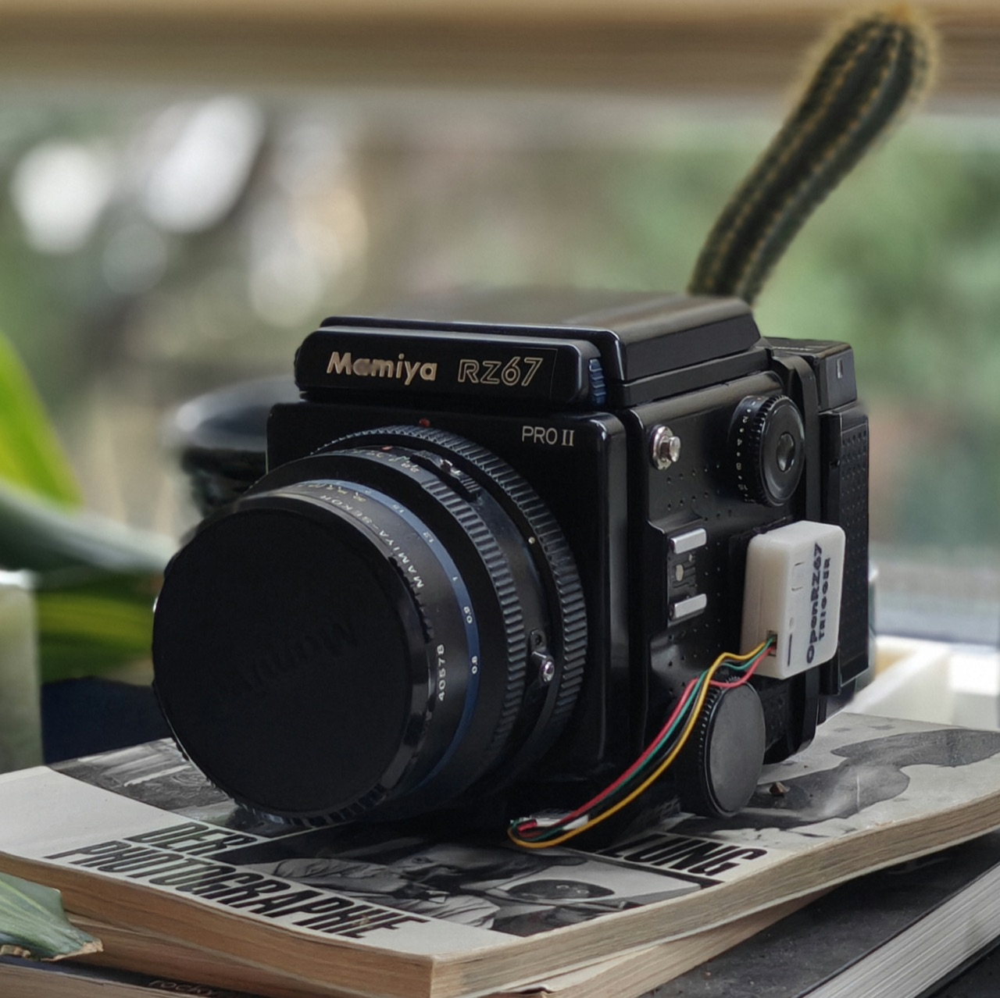

A Bluetooth remote release for the Mamiya RZ67. A small box on a coin cell plugs into the
camera's remote port. An Android or iPhone app fires the shutter, holds it open for bulb, or
runs a countdown.

  
  
  

- Instant release, bulb, and a countdown of up to 4 minutes.
- Runs on a CR2032. It sleeps between uses and wakes on a button press.
- Nothing to solder. The board comes assembled from JLCPCB, everything else plugs in.
- Firmware updates over Bluetooth.

**[Build guide](build-guide.md)** · [Bluetooth protocol](protocol.md) · [Perfboard version](perfboard.md)

## Repositories

- **[openrz67](https://github.com/mhellevang/openrz67)**: board, case and firmware.
- **[openrz67-android](https://github.com/mhellevang/openrz67-android)**: Android app, APK on the
  [releases page](https://github.com/mhellevang/openrz67-android/releases/latest).
- **[openrz67-ios](https://github.com/mhellevang/openrz67-ios)**: iPhone app, built from source in Xcode for now.

[Support](support.md) · [Privacy](privacy.md) · Not affiliated with Mamiya.
